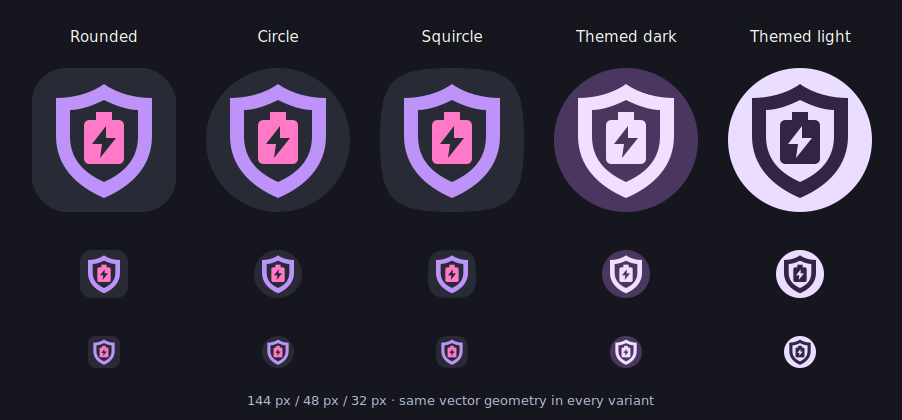

# Protected battery icon

Background Check's icon combines a purple privacy shield with a pink battery and a transparent lightning cutout. The dark background (`#282A36`), purple (`#BD93F9`), pink (`#FF79C6`) and bold, flat geometry make it a sibling to [Cana's Open C mark](https://github.com/jordanwoodson/cana/blob/4fc3ad3185f13ce667293d0c99958cf822386f7b/assets/branding/cana-mark.svg). The shield and battery identify Background Check's privacy and energy controls.

The editable source is [background-check-mark.svg](../assets/branding/background-check-mark.svg). Run `python3 scripts/generate-branding.py` to export the adaptive foreground, monochrome layer, splash drawable, Network settings icon and standalone SVG. All use the same paths; the themed layer retains the shield opening and lightning as transparent cutouts.

The adaptive foreground uses a 108 dp viewport. Its painted pixels remain within a 31.82 dp radius of the center, inside Android's 33 dp safe circle. Rounded, circular and squircle masks, plus light and dark themed colors, were visually checked at 144, 48 and 32 pixels against [Android's adaptive icon guidance](https://developer.android.com/develop/ui/compose/system/icon_design_adaptive).

## Verification

- JDK 21 and Android SDK 36: `./gradlew :app:testDebugUnitTest :app:lintRelease :app:assembleRelease` passed. The unit suite has 176 tests with no failures; release lint reports 0 errors, 305 warnings and 3 hints. See the [release gate log](../artifacts/verification-icon/release-gate.log).
- Regenerating the exports produced identical files. All four Android vectors use the canonical SVG paths and even-odd fill rules, preserving both cutouts.
- The signed, minified release APK installed and launched successfully on a fresh Android API 36 emulator. The actual adaptive icon was visually checked in [Android App info](../artifacts/verification-icon/android-api36-app-info.png).
- The APK's [signing certificate](../artifacts/verification-icon/signature.txt) matches the established SHA-256 fingerprint `3d770ebfa7c2eacd7735adc9fadca193b62e59424659aed58afe2243c1879951`. Version defaults, signing configuration and release workflow are unchanged.
